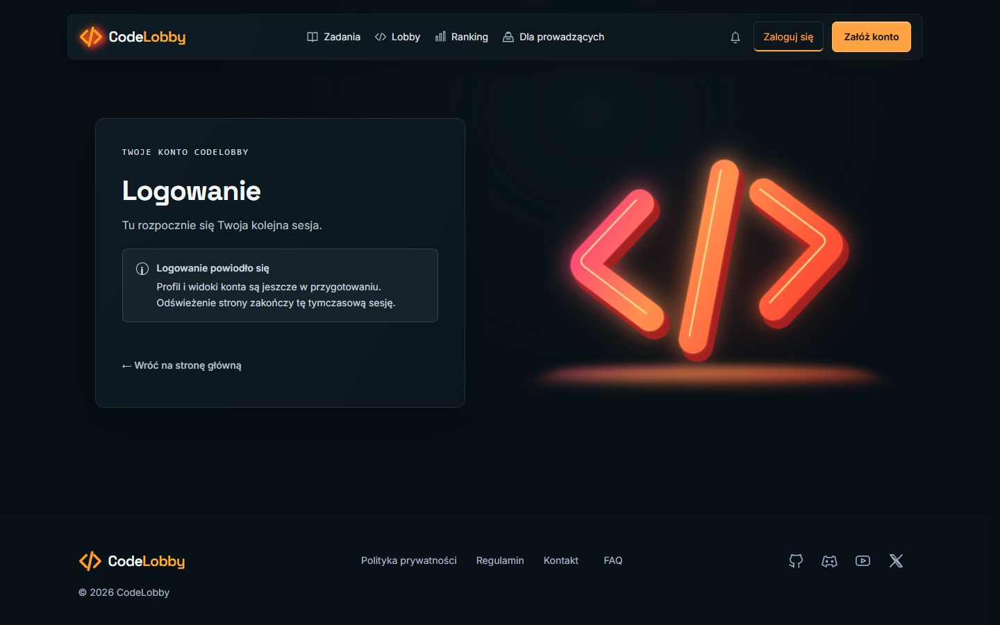

# Lokalna integracja frontend / backend / PostgreSQL

## Konfiguracja — 2026-10-30

- Microsoft OpenJDK 21.0.13, wybrany dla backendu przez skrypt startowy.
- Docker Desktop i istniejący Compose z repo infra, bez zmian w jego definicji.
- PostgreSQL 17: `127.0.0.1:55433`, baza i użytkownik `codelobby`.
- Trwały wolumen `codelobby-local_postgres_data`; konta są tylko lokalne.
- Backend: `http://127.0.0.1:8080`, health `UP`; 4 migracje Flyway zastosowane.
- Frontend: `http://127.0.0.1:5173`, proxy `/api` do lokalnego backendu.
- Losowe hasło PostgreSQL i 32-bajtowy sekret JWT są w ignorowanym
  `codelobby-infra/.env`, jako POSTGRES_PASSWORD i JWT_SECRET_BASE64. Nie trafiają
  do repo, VITE_* ani instrukcji. Zachowano stały sekret JWT między restartami.

## Ponowne uruchomienie w Windows

Uruchom Docker Desktop. Następnie w katalogu codelobby-web, w pierwszym terminalu:

```powershell
.\scripts\start-local-backend.ps1
```

Skrypt odczytuje lokalną konfigurację, uruchamia bazę, czeka na healthcheck i
startuje backend z JDK 21. Pozostaw terminal otwarty. Pierwszy start pobiera
zależności Maven; kolejne korzystają z lokalnego cache.

W drugim terminalu, także w codelobby-web:

```powershell
npm run dev
```

Zatrzymanie backendu: Ctrl+C w jego terminalu. Zatrzymanie bazy z katalogu infra:

```powershell
docker compose --env-file .env -f local/compose.yaml stop
```

Nie usuwaj wolumenu, jeśli chcesz zachować konta. To nie jest wspólna ani
produkcyjna baza i nie wymaga runnera.

## Sprawdzone prawdziwe endpointy

Wszystkie żądania auth i profilu przeszły przez `127.0.0.1:5173/api`, a więc
przez ten sam proxy co przeglądarka. Bez mocków odpowiedzi.

| Scenariusz                          | Wynik                               |
| ----------------------------------- | ----------------------------------- |
| Health backendu                     | UP                                  |
| POST /api/auth/register             | 201, rekord użytkownika             |
| Powtórzona rejestracja              | 409 EMAIL_ALREADY_EXISTS            |
| POST /api/auth/login                | 200, accessToken i tokenType Bearer |
| GET /api/users/me z wydanym JWT     | 200, właściwy email                 |
| Login ze złym hasłem                | 401 INVALID_CREDENTIALS             |
| Nieprawidłowy email / krótkie hasło | 400 VALIDATION_ERROR                |
| GET /api/users/me bez tokenu        | 401                                 |

Tokenów, haseł ani hashy nie wypisywano w wynikach. Konto utworzone przez
formularz potwierdzono w app_users, wraz z obecnością hasha hasła.

## Sprawdzone w przeglądarce

- /register → rzeczywiste utworzenie konta → /login z potwierdzeniem.
- Login z błędnym hasłem → bezpieczny komunikat bez ujawniania istnienia konta.
- Login z właściwym hasłem → potwierdzenie sukcesu i wyczyszczenie formularza.
- Powtórne użycie emaila w /register → czytelny komunikat o zajętym adresie.
- Formularze wysyłają żądania do działającego backendu; nie ma atrap sukcesu.

Pozostawiono lokalne konta testowe z domeną example.test. Użytkownik może
utworzyć własne konto na /register. Pełny profil, ochrona tras, logout i trwałość
sesji po reload pozostają zakresem web #17; odpytywanie /me w powyższej tabeli
było osobnym sprawdzeniem endpointu, nie deklaracją wdrożenia profilu w UI.

## Testy automatyczne

- Frontend: 51 testów w 7 plikach (sukcesy/błędy API, formularze i regresje).
- Backend: `mvnw.cmd -B -ntp -Dtest=AuthRegistrationIntegrationTest test`:
  28 testów, 0 failures/errors/skipped. Testcontainers używa osobnej bazy
  codelobby_test, niezależnej od lokalnych kont w codelobby.
- Backend i infra pozostają bez zmian śledzonych przez Git. PR #16 obejmuje
  frontend, skrypt startowy i instrukcje; lokalne sekrety pozostają poza Git.

## Przykład interfejsu

Potwierdzenie rzeczywistego logowania z animowanymi klamrami obok formularza:


